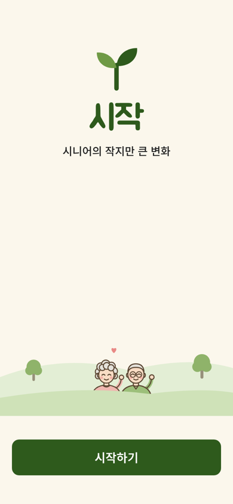
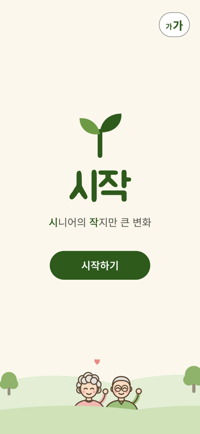
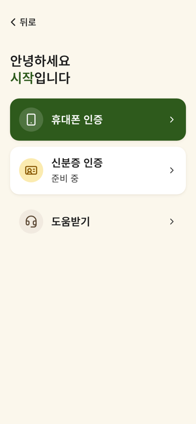
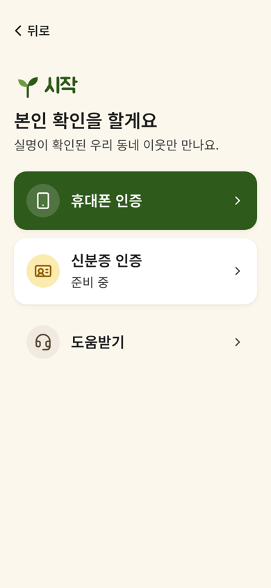

# 시작 화면 전후 비교 — 무엇이 좋아졌나 (A22 · A25)

> 폴리싱 작업 참고용. 기존 시작 화면(①)과 A22 반영 후를 비교하고, 각 변화가 **왜** 나아졌는지와 **다른 화면에도 쓸 수 있는 원칙**을 함께 적었다.
> 작업 범위·완료 기준은 `docs/tasks/A22-welcome-screen.md`, 시작 → 본인 확인 전환은 `docs/tasks/A25-login-continuity.md`.

| 기존 | A22 반영 후 |
|---|---|
|  |  |

(정지 화면 기준. 등장 연출은 실제 앱에서 처음 열 때 확인)

---

## 한눈에

| 항목 | 기존 | 개선 | 좋아진 점 |
|---|---|---|---|
| 첫인상 | 정지된 그림 | 새싹이 자라고 두 잎이 펼쳐지는 2초 연출 | 로고 의미(두 사람의 만남)가 설명 없이 전달되고, 시연에서 기억에 남는다 |
| 글씨 크기 | 가입 후 마이페이지 → 화면 설정에서만 | 첫 화면 오른쪽 위 '가가' | 글을 읽기 전에 글씨부터 키울 수 있다 |
| 슬로건 | 로고와 같은 무게(굵은 검정) | '시'·'작'만 초록, 나머지는 보통 굵기 회갈색 | 주인공(로고)이 분명해지고 '시작' 말장난이 드러난다 |
| 배치 | 로고는 위에 붙고 가운데가 크게 빔 | 로고·슬로건·버튼이 가운데 한 묶음 | 빈 구멍이 사라지고 시선이 한 줄로 흐른다 |
| 시작하기 버튼 | 폭을 꽉 채운 막대, 언덕 아래 따로 | 묶음 안의 작은 둥근 버튼 | 양식 제출 버튼이 아니라 초대처럼 보이고 장면과 어울린다 |
| 언덕 그림 | 버튼 위 띠, 노부부가 작음 | 맨 아래 배경, 조금 더 크게 | 화면 아래가 그림으로 마무리되고 '사람'이 더 잘 보인다 |
| 다음 화면으로 | 화면이 통째로 바뀜, ② 제목 「안녕하세요 시작입니다」 | 새싹이 ② 로고 자리로 날아가 붙고, ② 제목 「본인 확인을 할게요」 | 화면이 '이어지고', ②에서 할 일과 이유가 바로 보인다 |

---

## 항목별로

### 1. 정지 화면 → 의미 있는 등장 연출
- **기존**: 열자마자 모든 요소가 한 번에 떠 있는 정지 화면. 깔끔하지만 인상이 약했다.
- **개선**: 줄기가 자라고 → 두 잎이 차례로 펼쳐지고 → 이름이 흐릿함에서 또렷해지고 → 슬로건 → 버튼 → 언덕 위 노부부와 하트. 다 나온 뒤엔 잎이 아주 살짝 흔들린다.
- **좋아진 점**
  - 로고의 두 잎을 "서로 다른 두 사람이 한 줄기에서 만난다"로 읽히게 해서, 서비스의 핵심(이웃과의 만남)을 첫 2초에 전달한다.
  - 시연·발표에서 첫 장면이 기억에 남는다.
- **지킨 선**: 열 때마다 같은 연출(약 2초). 버튼은 연출 중에도 누를 수 있고, '움직임 줄이기' 기기에선 연출 없음. 번쩍임·깜빡임 없음.
- **다른 화면에 쓸 원칙**: 움직임은 **주인공 하나만, 짧게, 의미가 있을 때만**. 장식용 움직임을 여기저기 흩뿌리지 않는다. 어르신이 기다리게 만들지 않는다.

### 2. 글씨 크기를 첫 화면에서
- **기존**: 글씨 크기를 바꾸려면 가입을 마치고 마이페이지 → 화면 설정까지 가야 했다. 정작 글씨가 작아 힘든 순간(가입 화면)에는 바꿀 방법이 없었다.
- **개선**: 첫 화면 오른쪽 위 '가가' 버튼. 누르면 '더 크게', 다시 누르면 보통. 화면 설정과 같은 값이라 어디서 바꿔도 이어진다.
- **좋아진 점**
  - 가입 과정 전체를 큰 글씨로 진행할 수 있다.
  - 심사에서 "어르신 중심 설계"를 첫 화면부터 보여 주는 근거가 된다.
- **표현**: 처음엔 "글씨 크게" 글자를 붙였지만, '가가' 모양이 포털·은행 앱에서 익숙한 표시라 모양만 남겼다. 화면 읽기 기능에선 "글씨 크게"로 읽힌다.
- **다른 화면에 쓸 원칙**: 접근성 설정은 **필요해지는 순간보다 먼저** 닿을 수 있어야 한다. 같은 설정을 여러 곳에 두면 반드시 **한 값**으로 묶는다.

### 3. 슬로건의 위계와 말장난
- **기존**: 슬로건이 굵은 검정이라 로고 '시작'과 무게를 다퉜다.
- **개선**: 나머지 글자는 보통 굵기의 따뜻한 회갈색, '**시**니어의 **작**지만'의 두 글자만 로고와 같은 초록.
- **좋아진 점**
  - '시작'이 확실한 주인공이 되고, 슬로건은 한 발 물러난다.
  - 슬로건이 이름을 설명하는 장치가 된다(앞글자 = '시작').
- **지킨 선**: 회갈색도 배경 대비 7:1(앱 공통 기준). 더 연하게 해서 말장난을 크게 강조하는 안은 대비가 부족해 제외. 선명한 화면에선 흰색 + 노랑.
- **다른 화면에 쓸 원칙**: 위계는 크기보다 **굵기와 색**으로 먼저 정리한다. 강조는 최소 단위(두 글자)로. 흐리게 만들 때도 대비 기준은 깨지 않는다.

### 4. 빈 가운데 → 한 묶음 배치
- **기존**: 로고 묶음이 위에 붙어 있고, 슬로건과 언덕 사이가 크게 비었다. 버튼은 화면 맨 아래에 따로 있었다.
- **개선**: 새싹 → '시작' → 슬로건 → 시작하기를 가운데 한 덩어리로. 묶음을 한 단계 크게, 위아래 여백은 2 : 1 비율.
- **좋아진 점**
  - 가운데 구멍이 사라지고 화면이 꽉 짜인다.
  - "이게 뭔지 보고 → 바로 누르는" 순서로 시선이 한 줄로 흐른다.
  - 휴대폰 높이가 달라도 같은 인상(짧은 화면에선 언덕이 먼저 줄어든다).
- **다른 화면에 쓸 원칙**: 여백은 고정 값보다 **비율**로 나눠야 기기마다 같은 인상이 나온다. 관련 있는 요소는 붙이고, 남는 공간은 한곳에 모으지 말고 나눈다.

### 5. 시작하기 버튼 — 막대에서 초대로
- **기존**: 화면 폭을 꽉 채운 진한 막대가 언덕 아래 크림색 띠 위에 따로 놓여, 그림 한 장과 입력 양식 버튼이 쌓인 느낌이었다.
- **개선**: 슬로건 아래, 폭 약 절반의 둥근 버튼.
- **좋아진 점**
  - 버튼이 로고 묶음의 일부가 되어 장면과 따로 놀지 않는다.
  - "제출"이 아니라 "들어오세요" 하는 초대처럼 보인다.
- **검토했다가 뺀 안**: 로고 위 가운데(엄지에서 멀고, 앱을 알기 전에 버튼이 먼저 보임), 버튼 없이 자동으로 넘어가기(화면이 저절로 바뀌면 당황하기 쉬움).
- **지킨 선**: 높이는 최소 터치 영역 56 그대로. 크기를 줄일 땐 높이가 아니라 폭을 줄인다. 글씨를 키우면 버튼도 넓어진다.
- **다른 화면에 쓸 원칙**: 꽉 찬 막대 버튼은 **양식의 마지막 행동**(가입 완료, 신청하기)에 어울린다. 소개·환영 화면의 버튼은 내용과 한 묶음으로 두는 편이 자연스럽다.

### 6. 언덕 그림 — 띠에서 바닥으로
- **기존**: 버튼 위에 낮게 걸친 띠, 노부부가 작게 보였다.
- **개선**: 버튼이 빠진 자리까지 내려와 화면 아래 끝에 붙고, 높이를 늘려 노부부가 더 크게.
- **좋아진 점**: 화면 아래가 그림으로 마무리되고, 화면에서 유일하게 '사람'을 보여 주는 장면에 존재감이 생겼다.
- **지킨 선**: 더 키우면 양옆 나무가 잘려 그 직전에서 멈춤. 선명한 화면에선 기존 규칙대로 풍경을 숨긴다.

### 7. 시작 → 본인 확인 — 끊긴 화면에서 이어지는 화면으로 (A25)

| 기존 ② | A25 반영 후 ② |
|---|---|
|  |  |

- **기존**: '시작하기'를 누르면 화면이 통째로 바뀌었다. ② 제목 「안녕하세요 시작입니다」는 인사일 뿐, 이 화면에서 무엇을 하는지 말해 주지 않았다.
- **개선**
  - 시작 화면의 큰 새싹이 작아지며 ② 위쪽 '시작' 로고 자리로 날아가 붙는다(약 0.6초). 나머지는 짧게 엇갈려 바뀐다.
  - ② 머리를 작은 새싹 + '시작' 로고 → 제목 「본인 확인을 할게요」 → 한 줄 「실명이 확인된 우리 동네 이웃만 만나요.」 순서로.
- **좋아진 점**
  - 화면이 '바뀌는' 게 아니라 '이어진다' — 같은 앱 안에서 다음 단계로 들어간다는 감각. 시작 화면의 주인공(새싹)이 다음 화면에서도 같은 존재로 남는다.
  - 제목이 이 화면의 할 일을 바로 말하고, 한 줄 안내가 **왜** 본인 확인을 하는지(실명 이웃·안심)를 첫 단계에서 알린다.
- **지킨 선**: 지원하지 않는 브라우저나 '움직임 줄이기' 기기에서는 전환 없이 바로 이동. 인증 방법 세 가지와 순서는 그대로. 로고 글자는 그림처럼 크기 고정.
- **다른 화면에 쓸 원칙**
  - 화면이 넘어갈 때 **앞 화면의 주인공을 다음 화면까지 데려가면** 흐름이 끊기지 않는다. 다만 전환은 한 요소만, 짧게.
  - 화면 제목은 인사보다 **이 화면에서 할 일**을 말한다. 그 아래 한 줄로 이유를 붙이면 어르신이 망설이지 않는다.

---

## 폴리싱 체크리스트 (이번 작업에서 뽑은 것)
- [ ] 이 화면의 주인공은 하나인가? 나머지는 굵기·색으로 물러나 있는가
- [ ] 화면 가운데나 아래에 이유 없이 빈 구멍이 있지 않은가
- [ ] 버튼이 내용과 한 묶음인가, 따로 떨어져 있는가
- [ ] 여백을 고정 값이 아니라 비율로 나눠 작은·큰 휴대폰에서 같은 인상인가
- [ ] 움직임이 있다면 의미가 있고, 짧고, 기다리게 하지 않고, '움직임 줄이기'를 존중하는가
- [ ] 크기를 줄여도 터치 영역 56·대비 7:1은 그대로인가
- [ ] 접근성 기능(글씨 크기 등)이 필요한 순간보다 먼저 닿는가
- [ ] 화면 제목이 인사가 아니라 '이 화면에서 할 일'을 말하는가, 이유가 한 줄로 붙어 있는가
- [ ] 화면이 넘어갈 때 흐름이 끊기지 않는가 (같은 요소가 이어지거나, 최소한 갑자기 바뀌지 않는가)

## 남은 것
- '시작하기'를 누르면 새싹이 다음 화면 머리로 날아가 붙는 전환 — A25에서 반영 (`docs/tasks/A25-login-continuity.md`)
