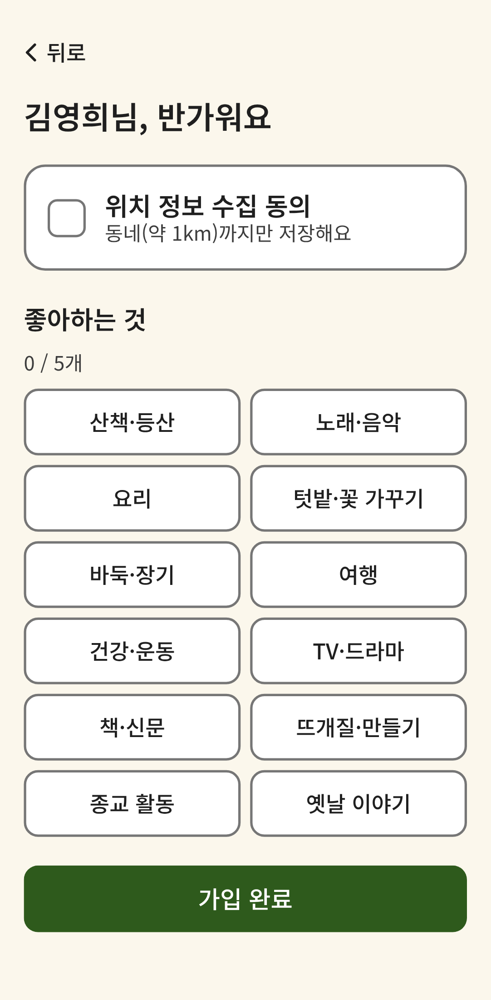
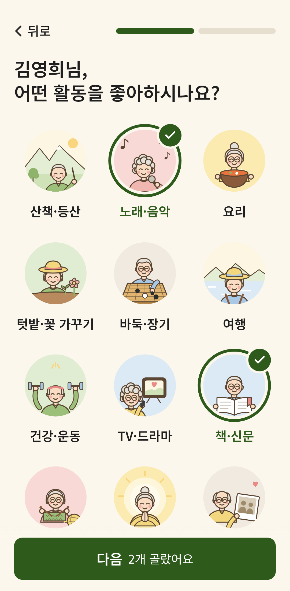

# 가입 '좋아하는 것' 전후 비교 (A24)

> 작업 범위·완료 기준은 `docs/tasks/A24-interest-select.md`.

| 기존 | A24 반영 후 |
|---|---|
|  |  |

## 한눈에

| 항목 | 기존 | 개선 | 좋아진 점 |
|---|---|---|---|
| 질문 | 위치 동의 + 좋아하는 것, 한 화면에 둘 | 1/2 좋아하는 것 → 2/2 사는 동네 | 한 번에 한 가지만 생각하면 된다 |
| 제목 | "○○님, 반가워요" + 작은 묶음 이름 '좋아하는 것' | "○○님, 어떤 활동을 좋아하시나요?" 하나 | 화면의 주인공이 질문 자체가 된다 |
| 선택지 | 회색 테두리 글자 버튼 12개 | 둥근 그림 + 이름 3열 (A19 그림체, 어르신이 그 활동을 하는 장면) | 글을 읽기 전에 그림으로 알아본다, 양식이 아니라 '고르는 재미', 앱 다른 그림과 한 가족 |
| 선택 표시 | 버튼 전체가 초록으로 칠해짐 | 사진 둘레 고리 + ✓ + 이름 초록 | 사진은 그대로 보이면서 고른 것이 분명하다 |
| 개수 | 묶음 위 "0 / 5개" 작은 글씨 | 버튼 안 "다음 2개 골랐어요" | 숫자를 행동 바로 옆에서 확인 |
| 버튼 | 목록 맨 아래 (내려야 보임) | 화면 아래에 늘 붙어 있음 | 어디서 끝내는지 찾지 않는다 |

## 다른 화면에 쓸 원칙
- 한 화면에 **질문 하나**. 여러 개를 물어야 하면 단계로 나누고 막대로 남은 양을 보여 준다
- 고를 대상이 **눈으로 알아볼 수 있는 것**(활동·장소)이면 글자 버튼보다 그림·사진. 단, 이름은 반드시 함께 — 그림은 꾸밈, 의미는 글자로
- 외부 사진은 시연 환경에 따라 안 뜰 수 있다 — 핵심 화면의 그림은 **앱 안에** 두고, 그림체는 앱의 기존 일러스트에 맞춘다
- 선택 표시는 **내용을 가리지 않는 방식**(테두리·✓)으로, 색만으로 전달하지 않는다
- 아직 할 수 없는 행동은 오류창보다 **버튼 자체가 할 일을 말하게**
- 사진을 못 불러올 때는 어설픈 대체 그림보다 **조용한 빈칸**이 낫다 — 의미는 이름 글자가 이미 전한다
- 칸 수는 글자 크기와 함께 생각한다 — 큰 글씨에서 이름이 잘게 끊기면 칸을 줄인다

## 폴리싱 체크리스트 (A22에 더해)
- [x] 이 화면의 주인공은 하나인가 — 제목 질문
- [x] 버튼이 내용과 떨어져 길을 잃지 않는가 — 하단 고정
- [x] 크기를 줄여도 터치 영역·대비는 그대로인가 — 둥근 칸 전체 + 이름이 누르는 곳
